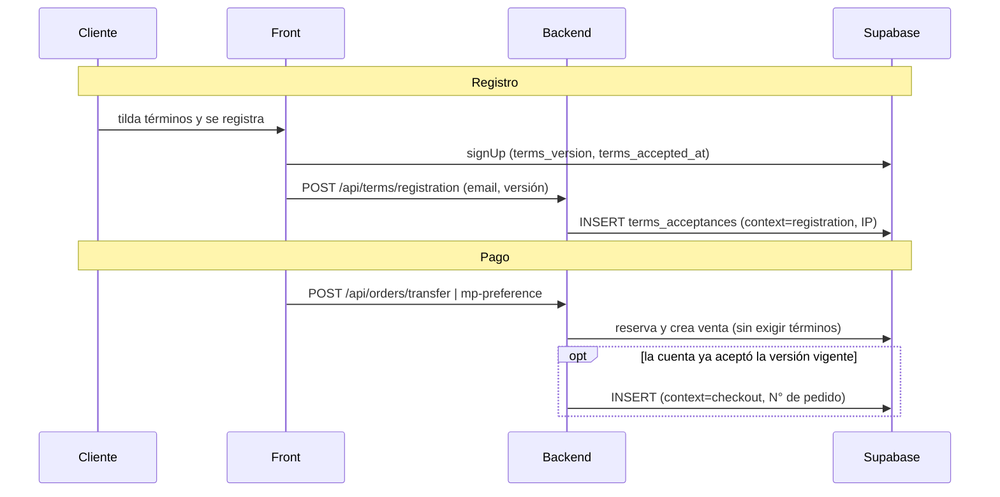

# Flujo: Aceptación de Términos y condiciones

## Objetivo
Dejar constancia de qué versión de los Términos aceptó cada cuenta, y pedir una nueva aceptación solo cuando el texto cambia de forma importante.

## Actores
- Cliente (con o sin cuenta).
- Admin del negocio.
- Backend (`/api/terms/*`, `/api/orders/*`) y Supabase (`site_content`, `terms_acceptances`, Auth).

## Pre-condiciones
- Script SQL `2026-10-28_terms_acceptance_and_withdrawal_search_fields.sql` aplicado (tabla `terms_acceptances` con `context`).
- Comprar exige tener cuenta (el checkout está detrás de login).

## Versión vigente
- La publica el admin en **Admin → Términos y condiciones**: se guarda en `site_content`, clave `legal_terms`, como `{ version, body, updatedAt }`.
- Sin publicación, rige `DEFAULT_TERMS_VERSION` (`utils/termsVersion.js` en el backend y `termsVersion.ts` en el front; deben coincidir).
- Formato de versión: `AAAA-MM-DD`, y `.2`, `.3`… si se publica más de una el mismo día.
- "Corrección menor" conserva la versión; "cambio importante" genera una nueva y obliga a volver a aceptar.

## Pasos principales (happy path)
1. **Registro:** el cliente tilda "Acepto los Términos y la Política de privacidad". El front crea la cuenta con `terms_version` y `terms_accepted_at` en los datos del usuario y envía `POST /api/terms/registration` (constancia con IP).
2. **Pago:** el checkout ya NO pide ni muestra los términos; se aceptan solo al crear la cuenta.
3. **Checkout:** el backend NO bloquea la compra por los términos. Si la cuenta ya había aceptado la versión vigente (tilde del registro o `POST /api/terms/accept`), guarda una fila `checkout` con el N° de pedido y la versión que fija el servidor; si no la había aceptado, la compra sigue y no se registra constancia.

## Caminos alternativos
- Si el admin publica una versión nueva: `POST /api/terms/accept` con la versión vieja responde 409 `TERMS_VERSION_OUTDATED`. Las compras siguen sin bloquearse; solo dejan de registrar constancia hasta que la cuenta acepte la nueva.
- Si falla `POST /api/terms/registration`: el registro sigue (es solo evidencia).

## Errores esperados
- `POST /api/terms/accept` con base caída → 500 con mensaje humano.
- Si falla el guardado de la constancia de compra, la compra igual se crea (queda `terms_acceptance_not_saved` en el log).
- Checkout sin aceptación vigente → NO hay error: la compra se crea sin constancia (ya no existe `TERMS_NOT_ACCEPTED` en el checkout).

## Diagrama

## Datos involucrados
- `site_content` (`legal_terms`): lectura pública, escritura solo admin (RLS).
- `terms_acceptances`: `user_id`, `buyer_email`, `order_number`, `terms_version`, `ip`, `context` (`registration` / `reacceptance` / `checkout`), `accepted_at`. RLS sin policies: solo el backend la lee y escribe.
- `user_metadata.terms_version` (Supabase Auth): la versión que tildó al registrarse. Vale como aceptación solo si coincide con la vigente.

## Seguridad
- La versión que se guarda y la que se compara las decide el servidor; el body del cliente no la fija.
- `/api/terms/registration` es público y solo deja evidencia: nunca habilita una compra, así que no se puede falsificar una aceptación a nombre de otra persona.
- El texto editable se muestra sin HTML crudo; solo se enlazan rutas internas (`/…`) y `https://`.
