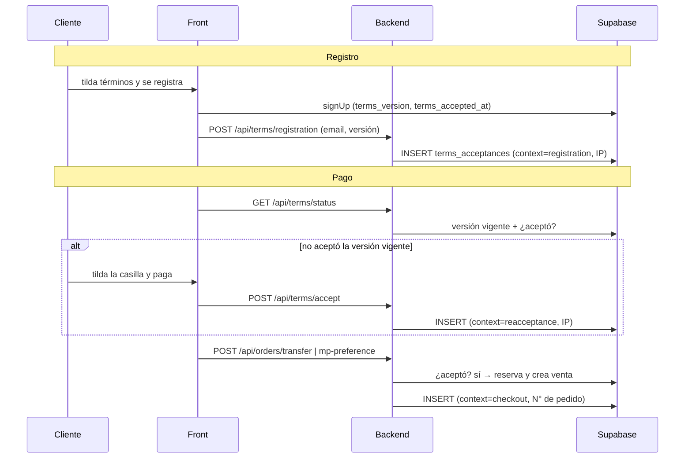

# Flujo: Aceptación de Términos y condiciones

## Objetivo
Dejar constancia de qué versión de los Términos aceptó cada cuenta, y pedir una nueva aceptación solo cuando el texto cambia de forma importante.

## Actores
- Cliente (con o sin cuenta).
- Admin del negocio.
- Backend (`/api/terms/*`, `/api/orders/*`) y Supabase (`site_content`, `terms_acceptances`, Auth).

## Pre-condiciones
- Script SQL `2026-10-28_terms_acceptance_and_withdrawal_search_fields.sql` aplicado (tabla `terms_acceptances` con `context`).
- Comprar exige tener cuenta (el checkout está detrás de login).

## Versión vigente
- La publica el admin en **Admin → Términos y condiciones**: se guarda en `site_content`, clave `legal_terms`, como `{ version, body, updatedAt }`.
- Sin publicación, rige `DEFAULT_TERMS_VERSION` (`utils/termsVersion.js` en el backend y `termsVersion.ts` en el front; deben coincidir).
- Formato de versión: `AAAA-MM-DD`, y `.2`, `.3`… si se publica más de una el mismo día.
- "Corrección menor" conserva la versión; "cambio importante" genera una nueva y obliga a volver a aceptar.

## Pasos principales (happy path)
1. **Registro:** el cliente tilda "Acepto los Términos y la Política de privacidad". El front crea la cuenta con `terms_version` y `terms_accepted_at` en los datos del usuario y envía `POST /api/terms/registration` (constancia con IP).
2. **Pago, cuenta que ya aceptó la versión vigente:** el paso Pago muestra el aviso "Al pagar aceptás los Términos y condiciones (versión X)". Sin casilla.
3. **Pago, cuenta que no la aceptó** (cuentas anteriores al tilde del registro, o versión nueva): aparece la casilla. Al pagar, el front llama `POST /api/terms/accept` y recién después crea el pedido.
4. **Checkout:** el backend verifica la aceptación de la versión vigente y guarda una fila `checkout` con el N° de pedido y la versión que fija el servidor.

## Caminos alternativos
- Si el admin publica una versión nueva mientras el cliente está en el paso Pago: `accept` responde 409 `TERMS_VERSION_OUTDATED`; el front avisa, muestra la versión nueva y vuelve a pedir el tilde. No se crea el pedido.
- Si el cliente veía el aviso fijo y la versión cambió: el checkout responde 409 `TERMS_NOT_ACCEPTED`; recargar la página muestra la casilla.
- Si falla `POST /api/terms/registration`: el registro sigue (es solo evidencia).

## Errores esperados
- `GET /api/terms/status` falla → el pago queda bloqueado con "No pudimos verificar los términos y condiciones. Recargá la página e intentá de nuevo."
- `POST /api/terms/accept` con base caída → 500 con mensaje humano; no se crea el pedido.
- Checkout sin aceptación vigente → 409 `TERMS_NOT_ACCEPTED` con `currentVersion`, sin reservar stock.

## Diagrama

## Datos involucrados
- `site_content` (`legal_terms`): lectura pública, escritura solo admin (RLS).
- `terms_acceptances`: `user_id`, `buyer_email`, `order_number`, `terms_version`, `ip`, `context` (`registration` / `reacceptance` / `checkout`), `accepted_at`. RLS sin policies: solo el backend la lee y escribe.
- `user_metadata.terms_version` (Supabase Auth): la versión que tildó al registrarse. Vale como aceptación solo si coincide con la vigente.

## Seguridad
- La versión que se guarda y la que se compara las decide el servidor; el body del cliente no la fija.
- `/api/terms/registration` es público y solo deja evidencia: nunca habilita una compra, así que no se puede falsificar una aceptación a nombre de otra persona.
- El texto editable se muestra sin HTML crudo; solo se enlazan rutas internas (`/…`) y `https://`.
