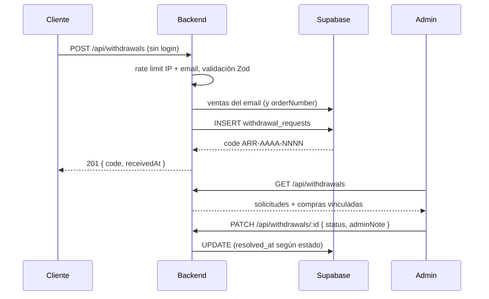
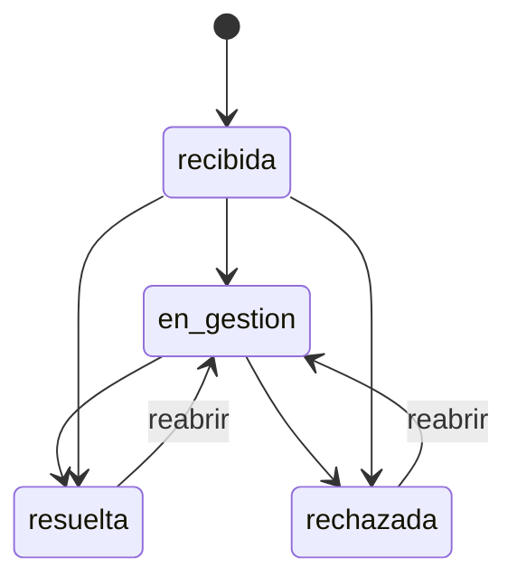

# Flujo: Botón de Arrepentimiento y número de pedido

## Objetivo
Registrar cada solicitud de arrepentimiento sin exigir login (Disposición 954/2025), devolver un código de seguimiento y darle al cliente un número de pedido que pueda citar.

## Actores
- Cliente (con o sin sesión).
- Admin (rol `admin`), que gestiona las solicitudes.
- Backend (`/api/withdrawals`, `/api/orders`).
- PostgreSQL/Supabase (`public.withdrawal_requests`, `public.ventas.order_number`).

## Pre-condiciones
- Script SQL `db/migrations/2026-10-27_order_number_and_withdrawal_requests.sql` aplicado ANTES de desplegar el backend.
- Para gestionar: admin con access token válido.

## Pasos principales (happy path)
1. En cada checkout (MP o transferencia) el backend pide UN número de pedido (`ventas_order_number_seq`, desde 1001) dentro de la transacción de reserva. Todas las filas de `ventas` del carrito lo comparten, y la respuesta del checkout lo incluye como `order_number`.
2. "Mis compras" (`GET /api/orders/user`) devuelve `order_number` en cada fila (`null` en filas anteriores que no lo tengan).
3. El cliente envía `POST /api/withdrawals { name, email, description, orderNumber? }`, sin sesión. `orderNumber` es opcional.
4. El backend valida en el borde, busca en `ventas` las compras del email (activas, no vencidas ni canceladas; si vino `orderNumber`, solo las de ese número) y guarda la solicitud con `venta_ids` y `needs_review = false`.
5. Responde 201 `{ success, code: 'ARR-AAAA-NNNN', receivedAt }`. El código lo genera la base con una secuencia: no hay carrera entre dos solicitudes.
6. El admin lista (`GET /api/withdrawals?status=&limit=&offset=`), ve las compras vinculadas y cambia estado y nota (`PATCH /api/withdrawals/:id { status?, adminNote? }`). Al pasar a `resuelta` o `rechazada` se fija `resolved_at`; al reabrir se limpia.

## Caminos alternativos
- Si no hay compras del email (o no coinciden con el `orderNumber`), la solicitud se guarda igual con `needs_review = true`: nunca se rechaza por no-match. El admin la revisa a mano.
- La respuesta del paso 5 es idéntica con o sin coincidencia, para que el endpoint no sirva para averiguar qué emails tienen compras.
- Compras anteriores al script SQL: el backfill agrupa por `mp_external_reference`; las transferencias sin referencia reciben un número cada una.

## Errores esperados
- Datos inválidos (email, textos vacíos o largos, `orderNumber` no entero positivo, campos extra) → 400 `VALIDATION_ERROR` con `details`.
- Más de 5 solicitudes por hora con el mismo email, o más de 10 en 10 minutos desde la misma IP → 429 `RATE_LIMITED`.
- Sin token / usuario común en rutas admin → 401 / 403.
- Estado inválido en el filtro → 400 `INVALID_STATUS`; id mal formado → 400 `INVALID_WITHDRAWAL_ID`; id inexistente → 404 `WITHDRAWAL_NOT_FOUND`.
- Error de base → 500 `INTERNAL_ERROR` genérico, sin detalles internos.

## Diagrama

## Datos involucrados
- Entradas: nombre, email, descripción de la compra, número de pedido opcional.
- Salidas: código de seguimiento y fecha de recepción.
- Persistencia: `public.withdrawal_requests` (RLS sin policies ni grants a `anon`/`authenticated`: solo el backend) y `public.ventas.order_number`.
- El backend no envía el mail de constancia: la norma pide informar el código "por el mismo medio" (la respuesta de la API), y el frontend debe mostrarlo.
