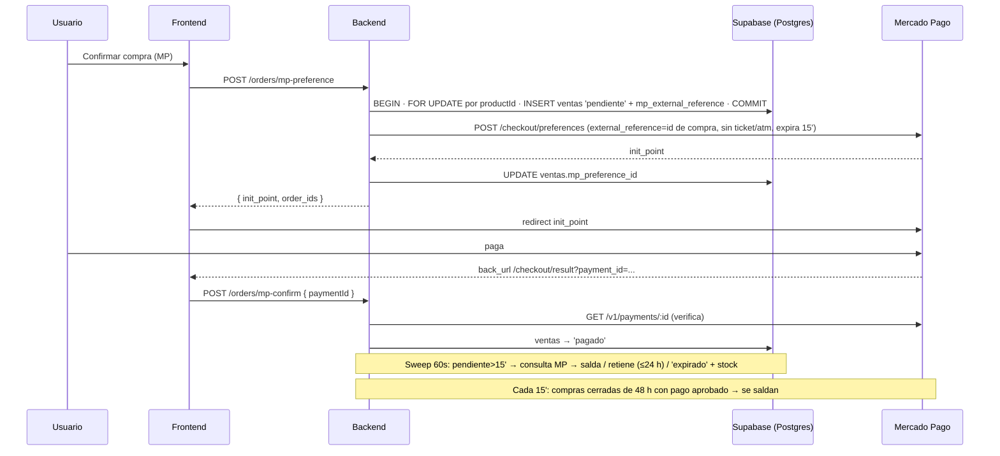

# Flujo: Checkout y ciclo de vida de una orden

## Objetivo
Comprar productos pagando con Mercado Pago o por transferencia, manteniendo el
stock y el estado de pago consistentes entre frontend, backend y Supabase.

## Actores
- Usuario (logueado vía Supabase Auth)
- Frontend React (checkout / checkout result / mis compras)
- Backend Express (`/api/orders`, `/api/shipping`)
- Mercado Pago (checkout externo + API de pagos)
- Admin (panel Ventas: transferencias)

## Pre-condiciones
- Usuario autenticado (el checkout lo exige; el token Bearer viaja vía `apiFetch`).
- Producto activo con stock suficiente.
- Para MP: `MP_ACCESS_TOKEN` configurado en el backend (si falta → 503 con mensaje claro).
- Modo de compra restringida (ver sección abajo) desactivado, o el usuario debe
  estar en la allowlist.

## Modo de compra restringida (allowlist de compradores)
Gate previo a `mp-preference`/`transfer`, antes de tocar stock. El admin marca a
uno o varios usuarios como "comprador habilitado"
(`profiles.purchase_allowed_exclusive`, vía `PUT /api/users/:id`) desde
`admin/pages/Users`. No hay un switch global aparte: el modo restringido está
activo mientras exista **al menos un** perfil marcado
(`User.getPurchasePermission`, `EXISTS (... WHERE purchase_allowed_exclusive)`).
- Con el modo activo, `POST /api/orders/mp-preference` y `POST /api/orders/transfer`
  responden `403 { code: 'PURCHASES_DISABLED' }` a cualquier usuario no marcado,
  antes de reservar stock (`orderController.blockIfPurchaseNotAllowed`). El
  frontend muestra el mensaje tal cual: "Por el momento no es posible comprar.
  Sitio en mantenimiento, gracias por tu paciencia."
- Al desmarcar al último usuario, el modo se desactiva solo y la compra vuelve
  a estar habilitada para todos.
- Pensado para "modo mantenimiento" controlado en producción (ej. probar el
  checkout con una sola cuenta antes de habilitar la compra pública).

## Modelo de stock (importante)
El descuento de stock lo hace el **trigger `trg_decrement_stock`** (AFTER INSERT en
`ventas`), que existe en la base de datos. El backend NO descuenta al crear órdenes:
- **Crear orden (INSERT en `ventas`)** → el trigger descuenta stock.
- **Antes de insertar**, el backend valida disponibilidad con la fila del producto
  bloqueada (`SELECT stock … FOR UPDATE`); si no alcanza, 409 y rollback (evita
  la sobreventa que el trigger permitiría con su `GREATEST(stock,0)`).
- **Cancelar / expirar** → el backend restaura el stock.
- **Pago acreditado después de expirar** → el backend vuelve a descontar.

## Pasos principales (happy path — Mercado Pago)
1. Usuario confirma el pedido en `/checkout` y acepta el aviso de 15 minutos.
2. Front llama `POST /api/orders/mp-preference` con items, comprador y envío.
3. Backend: valida payload → **transacción corta**: bloquea los productos en orden de
   `productId` (`SELECT … FOR UPDATE`), valida stock total, talle y variantes contra la fila,
   inserta filas en `ventas` con `payment_status='pendiente'` (el trigger descuenta stock) y
   guarda en todas el **id de compra** (`mp_external_reference`, un uuid nuevo) → COMMIT →
   recién entonces crea la preferencia en MP (fuera de la transacción) con
   `external_reference` = id de compra, expiración 15 min y **medios diferidos excluidos**
   (`ticket`, `atm`: un pago en efectivo retenía el stock días) → guarda `mp_preference_id`.
   Nombre, imagen y precio de cada línea salen de `productos`, no del body.
4. Front guarda `mp_order_ids` en sessionStorage y redirige a `init_point`.
5. Usuario paga en Mercado Pago y vuelve a `/checkout/result?collection_status=approved&payment_id=...`.
6. Front llama `POST /api/orders/mp-confirm { paymentId }`; el backend verifica el
   pago contra la API de MP y marca las ventas como `'pagado'`. Limpia el carrito.
7. La compra aparece en "Mis compras" (`GET /api/orders/user?email=` — solo dueño o admin). Ese
   endpoint devuelve las `pagado` **y** las transferencias con `origin='wa_confirmado'` (en cualquier estado de pago).

## Idempotencia de la creación de órdenes
`mp-preference` y `transfer` aceptan el header `Idempotency-Key` (8-128 caracteres
`[A-Za-z0-9_-]`; el front manda un UUID por intento de compra y lo descarta tras el éxito).
- Misma key + mismo carrito tras un `201` → se devuelve la **misma respuesta** (mismas
  `order_ids` / `init_point`) sin reservar stock de nuevo. Se recuerda 10 min, por usuario y
  tipo de pago. Se guarda en memoria y en `public.idempotency_keys`, así sobrevive a un
  reinicio de Render.
- Misma key + carrito distinto (items, envío, costo, total, nombre o email del comprador) → `422 IDEMPOTENCY_KEY_REUSED`.
- Key con formato inválido → `400 IDEMPOTENCY_KEY_INVALID`.
- Solo se recuerdan los `201`: tras un `409` (stock) o `502` (MP) el reintento con la misma
  key se ejecuta de nuevo.
- Sin header: se mantiene el single-flight por carrito (colapsa solo requests simultáneas).
- Si la tabla `idempotency_keys` no existe o la base falla, el checkout NO se corta: la
  idempotencia cae a memoria (se pierde solo ante un reinicio) y se loguea un warn.
- Cambiar nombre o email genera otra key en el front (otra compra): la orden pendiente
  anterior, si existía, expira sola por el sweep.

## Caminos alternativos
- **Transferencia:** el front llama `POST /api/orders/transfer` al backend Express
  (con Bearer token Supabase del usuario logueado). El backend valida stock con
  `SELECT … FOR UPDATE`, inserta en `ventas` (el trigger descuenta stock) y devuelve
  `order_ids`. El front abre WhatsApp con el resumen. El admin luego la resuelve en el panel Ventas:
  - Confirmar → `PATCH /api/orders/:id/confirm-transfer` → `'pagado'` (el stock ya
    se descontó al insertar; no se vuelve a tocar).
  - Cancelar → `PATCH /api/orders/:id/cancel-transfer` → `'cancelado'` + stock restaurado.
  - **Pagó después de expirar (5 h)** → `PATCH /api/orders/:id/confirm-late-transfer` (solo
    `expirado`): vuelve a descontar stock con la fila bloqueada y pasa a `'pagado'`; si ya no hay
    unidades (o el producto se borró) queda `oversold = true` → `200 { oversold }` para que el admin
    reembolse o reponga.
- **Nudge post-WhatsApp (transferencia):** cuando el usuario vuelve a la pestaña tras
  abrir WhatsApp (evento `visibilitychange`), el front muestra "¿Pudiste completar tu
  compra?" y registra la respuesta vía `POST /api/orders/nudge { orderIds, response }`
  (auth, solo dueño o admin), que escribe `ventas.origin`:
  - *Sí, ya envié el comprobante* → `origin='wa_confirmado'` (sigue `pendiente`). Desde ese
    momento la compra aparece en "Mis compras" con el aviso "Verificando tu comprobante", y pasa a
    `pagado` (con seguimiento de despacho), `cancelado` o `expirado` según lo que resuelva el admin.
  - *Todavía no* → `origin='wa_sin_confirmar'` (sigue `pendiente`, stock retenido).
  - *No, cancelar* → `origin='wa_abandonado'` + `'cancelado'` + stock restaurado.
  Es best-effort: si falla, el sweep de 5 h expira la orden igual. Idempotente (solo
  actúa sobre órdenes `transfer` que sigan `pendiente`).
- **Usuario vuelve sin pagar (failure):** CheckoutResult llama
  `POST /api/orders/mp-cancel { orderIds }` con los `order_ids` guardados (la `external_reference`
  de la URL ya no son ids de venta). El backend consulta a MP **una vez por compra**, sin retener
  conexión del pool, y responde `outcome`:
  - `released` → `'cancelado'` + stock restaurado (o ya estaba cancelada/expirada);
  - `held` → hay un pago en curso o MP no respondió: la reserva se mantiene;
  - `paid` → hay un pago aprobado: se salda (`'pagado'`) y no se cancela.
  Precedencia del agregado: `paid > held > released`. Alguna venta ajena → 403 sin tocar nada.
  `POST /api/orders/:id/cancel` sigue disponible para una orden puntual (mismo criterio).
- **Webhook:** si `MP_WEBHOOK_URL` está configurada (o se configura en el panel de MP),
  MP notifica `POST /api/orders/mp-webhook` y el backend marca `'pagado'` sin
  depender del navegador del usuario.

## Errores esperados
- Modo de compra restringida activo y usuario no habilitado → 403 `PURCHASES_DISABLED`.
- Stock insuficiente al crear preferencia o transferencia → nada se persiste y el body trae
  `{ code, message, productId, size? }`: `OUT_OF_STOCK` 409 (total, producto inexistente o stock
  NULL), `SIZE_OUT_OF_STOCK` 409, `SIZE_UNAVAILABLE` 409 (talle eliminado), `SIZE_REQUIRED` 400,
  `INVALID_VARIANT` 400, `INVALID_PRODUCT_ID` 400. El `code` llega igual a través del single-flight
  y de la idempotencia (solo se recuerdan los 201).
- MP caído / token inválido → 502 `MP_UNAVAILABLE` "No se pudo conectar con Mercado Pago…"; la
  reserva se compensa (ventas `cancelado` + stock devuelto).
- Id de orden con formato inválido (no uuid) → 400 `INVALID_ORDER_ID`.
- `MP_ACCESS_TOKEN` ausente → 503 "Los pagos con Mercado Pago no están disponibles…".
- Consulta/cancelación de órdenes ajenas → 403.
- Orden ya pagada al intentar cancelar → 409.
- Cancelar con un pago aprobado o en curso en MP: aprobado → se salda y responde 409; en curso
  → `200 { released: false }` y la reserva se mantiene (la consulta a MP va antes de la
  transacción, sin retener el lock).

## Expiración (sweep cada 60 s en el backend)
- MP `pendiente` > 15 min: antes de expirar se le pregunta a MP por los pagos de esa compra
  (`external_reference`, `GET /v1/payments/search`, últimos 50 intentos):
  - **aprobado** → se salda (`pagado`, se guarda `mp_payment_id`);
  - **en curso** (`pending`/`in_process`/`authorized`) o consulta fallida → se retiene el stock
    hasta **24 h** desde la creación (sin medios diferidos, un pago en curso se resuelve rápido);
  - **ninguno**, o pasadas las 24 h → `'expirado'` + stock restaurado (total y talle).
  `in_mediation` (disputa de un pago ya aprobado) no retiene.
  Límites por ciclo: hasta `ORDER_SWEEP_MAX_MP_LOOKUPS` (10) consultas, 4 en paralelo. Rotación en
  memoria: primero las compras nunca consultadas o consultadas hace más; una compra retenida no se
  reconsulta antes de 5 min. Cada compra se procesa con su propio try/catch (un error no aborta el
  ciclo) y las transferencias son un paso independiente.
  Las compras con `review_reason` (ej. `amount_mismatch`) **no gastan consultas**: se expiran
  recién al pasar las 24 h y la marca queda para el admin.
  Las ventas sin `mp_external_reference` (anteriores a la conciliación) expiran por tiempo.
- Transferencia `pendiente` > 5 h → `'expirado'` + stock restaurado.
- **Conciliación de compras cerradas** (dentro del sweep, como máximo cada 15 min): toma compras MP
  `expirado`/`cancelado` de las últimas 48 h sin `review_reason` (máx. 10 por pasada, rotando) y, si
  MP tiene un pago `approved`, lo salda como pago tardío. Log `closed_order_reconciled`.
- Pago acreditado después de expirar: `mp-confirm`/webhook/conciliación pasa `'expirado'` →
  `'pagado'` y vuelve a descontar. Si ya no hay unidades (total o talle), el producto se borró o su
  stock es NULL, NO hace clamp: la venta queda `pagado` con `oversold = true` y un log
  `oversold_late_payment`; el panel Ventas la marca "Sin stock: reembolsar".
- **`review_reason`** (detección para el admin; no cambia estado ni stock):
  - `amount_mismatch` → pago aprobado cuyo monto no coincide con el total (o no es un número): no
    se salda; log `payment_amount_mismatch`.
  - `duplicate_payment` → segundo pago aprobado con otro `payment_id` para ventas ya pagadas; log
    `duplicate_approved_payment`.
  - `refunded` / `charged_back` → el webhook notifica un reembolso o contracargo del pago que saldó
    la venta; log `payment_reversed`.
- `external_reference` de pagos viejos (lista de ids de venta separados por coma) se sigue
  resolviendo: primero se buscan ventas con esa `mp_external_reference`; si no hay, se parsea la lista.

## Diagrama

## Datos involucrados
- **Entrada:** items (productId, cantidad, precios, variantes), comprador, envío.
- **Persistencia:** `public.ventas` (una fila por producto; el costo de envío se
  suma a la primera línea), `public.productos.stock`.
- **Estados de `payment_status`:** `pendiente → pagado | cancelado | expirado`
  (`fallido` no lo escribe ningún código; la base lo rechaza con `ventas_payment_status_check`).
- **Stock por talle:** `productos.variants[].stockByOption` lo valida y descuenta el backend en
  `reserveOrders` con la fila bloqueada (el trigger solo descuenta `stock`); cancelar/expirar
  lo devuelve al talle de cada unidad (`ventas.units_config`). Talle agotado → 409; unidad sin
  talle → 400. `units_config` se guarda saneado contra las variantes reales (`[]` si el producto
  no tiene variantes).
- **`ventas.review_reason`**: `null` · `amount_mismatch` · `duplicate_payment` · `refunded` ·
  `charged_back` (ver Expiración).
- **Edición de productos por el admin**: `PUT /api/products/:id` con `expectedUpdatedAt` devuelve
  409 `PRODUCT_CHANGED` si una compra cambió el producto mientras el admin lo editaba (no pisa el
  stock descontado). Borrar un producto con ventas `pendiente` → 409 `PRODUCT_HAS_PENDING_ORDERS`.
- **`ventas.origin`** (respuesta del nudge post-WhatsApp): `null` (sin responder / MP) ·
  `wa_confirmado` · `wa_sin_confirmar` · `wa_abandonado`.
