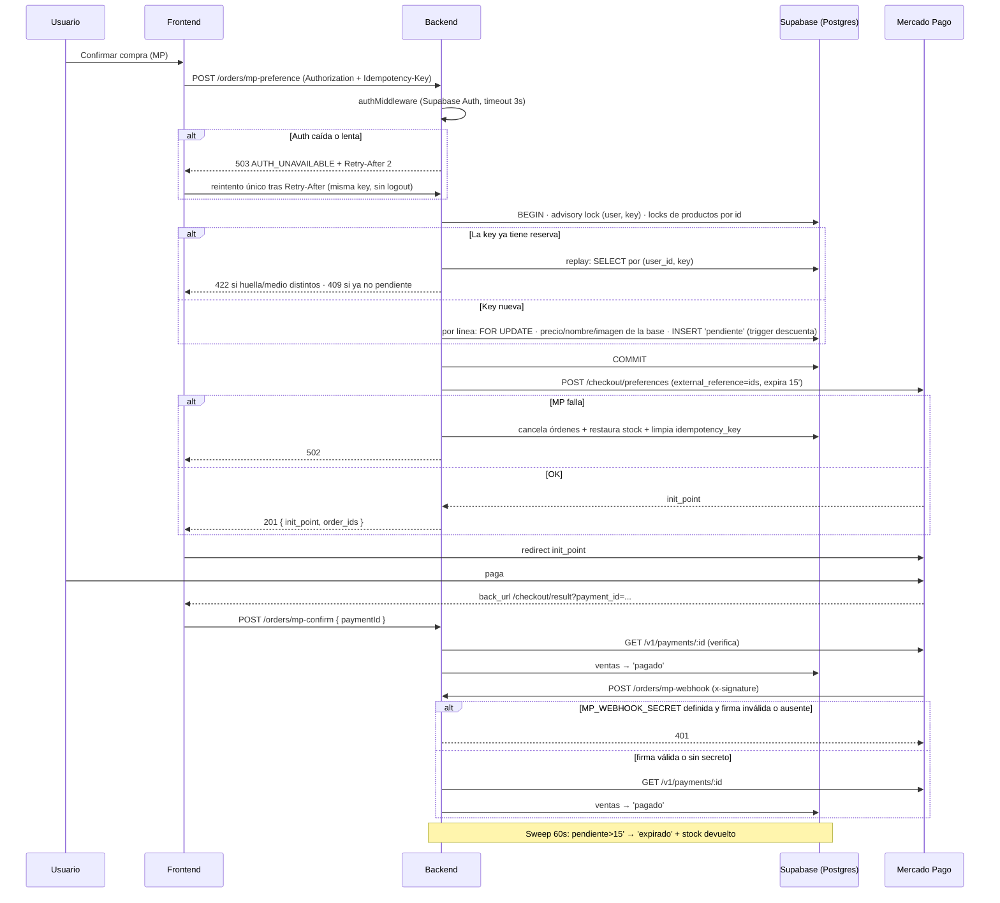

# Flujo: Checkout y ciclo de vida de una orden

## Objetivo
Comprar productos pagando con Mercado Pago o por transferencia, manteniendo el
stock y el estado de pago consistentes entre frontend, backend y Supabase.

## Actores
- Usuario (logueado vía Supabase Auth)
- Frontend React (checkout / checkout result / mis compras)
- Backend Express (`/api/orders`, `/api/shipping`)
- Mercado Pago (checkout externo + API de pagos)
- Admin (panel Ventas: transferencias)

## Pre-condiciones
- Usuario autenticado (el checkout lo exige; el token Bearer viaja vía `apiFetch`).
- Producto existente con stock suficiente (el backend no valida `status` del producto
  al reservar: solo existencia, stock y precio > 0).
- Script SQL `db/migrations/2026-10-06_idempotency_key.sql` aplicado en Supabase si el
  front manda `Idempotency-Key` (sin la columna `ventas.idempotency_key` el INSERT con key falla).
- Para MP: `MP_ACCESS_TOKEN` configurado en el backend (si falta → 503 con mensaje claro).
- Modo de compra restringida (ver sección abajo) desactivado, o el usuario debe
  estar en la allowlist.

## Modo de compra restringida (allowlist de compradores)
Gate previo a `mp-preference`/`transfer`, antes de tocar stock. El admin marca a
uno o varios usuarios como "comprador habilitado"
(`profiles.purchase_allowed_exclusive`, vía `PUT /api/users/:id`) desde
`admin/pages/Users`. No hay un switch global aparte: el modo restringido está
activo mientras exista **al menos un** perfil marcado
(`User.getPurchasePermission`, `EXISTS (... WHERE purchase_allowed_exclusive)`).
- Con el modo activo, `POST /api/orders/mp-preference` y `POST /api/orders/transfer`
  responden `403 { code: 'PURCHASES_DISABLED' }` a cualquier usuario no marcado,
  antes de reservar stock (`orderController.blockIfPurchaseNotAllowed`). El
  frontend muestra el mensaje tal cual: "Por el momento no es posible comprar.
  Sitio en mantenimiento, gracias por tu paciencia."
- Al desmarcar al último usuario, el modo se desactiva solo y la compra vuelve
  a estar habilitada para todos.
- Pensado para "modo mantenimiento" controlado en producción (ej. probar el
  checkout con una sola cuenta antes de habilitar la compra pública).

## Idempotencia del checkout (`Idempotency-Key`, desde 2026-10-06)
Header **opcional** en `POST /api/orders/transfer` y `POST /api/orders/mp-preference`
(`orderController.readIdempotencyKey`). El front genera un UUID por intento de compra
(`Checkout.tsx` → `getIdempotencyKey`) y lo reutiliza en los reintentos del mismo carrito.
- **Formato:** `^[A-Za-z0-9_-]{8,128}$` (sin `:`, que es el separador interno). Inválido ->
  `400 { code: 'INVALID_IDEMPOTENCY_KEY' }`, antes de tocar stock.
- **Persistencia:** cada línea del carrito (una fila de `ventas`) guarda
  `idempotency_key = <key>:<huella>:<índice de línea>` (`Order.buildStoredKey`). La huella
  son 12 hex de un sha256 (`utils/orderFingerprint.js`) sobre productos, cantidades,
  variantes (`unitsConfig`), `shippingMethod` y medio de pago; las líneas se ordenan antes
  de hashear, así que el orden del carrito no cambia la huella. **No incluye precios**
  (los fija el servidor) ni nombre/email del comprador. Las filas con formato anterior
  `<key>:<índice>` (sin huella) se reconocen y se reenvían sin comparar contenido.
- **Índice:** `ventas_user_idempotency_key_uidx` UNIQUE parcial sobre
  `(user_id, idempotency_key) WHERE idempotency_key IS NOT NULL`. Sin header el INSERT es
  el de siempre y no depende de la migración.
- **Serialización:** dentro de la transacción, `pg_advisory_xact_lock(hashtextextended('<userId>:<key>', 0))`
  (`Order.lockIdempotencyKey`) y después los locks de producto; recién entonces se busca
  una reserva previa. Dos requests simultáneas con la misma key quedan en fila: la
  segunda ve lo que commiteó la primera.
- **Replay** (`replayReservation`): si ya existe una reserva de ese `(user_id, key)` se
  devuelve con la misma forma que una reserva nueva (ids de órdenes, líneas valorizadas,
  envío reconstruido) **sin descontar stock de nuevo**. En MP se vuelve a crear la
  preferencia sobre esas órdenes.
- **Casos de rechazo del replay:**
  - Misma key con distinto medio de pago, o con huella distinta (otro carrito/envío) ->
    `422 { code: 'IDEMPOTENCY_KEY_REUSED' }`.
  - Replay de `mp-preference` cuando alguna de las órdenes ya no está `pendiente`
    (pagada, cancelada, expirada) -> `409` "Esta compra ya fue procesada, cancelada o venció. Iniciá una nueva compra." (sin `code`).
  - Replay de `transfer` no chequea estado: devuelve los ids originales.
- **Carrera residual:** si dos requests igualmente llegan al INSERT y una pisa el índice
  UNIQUE (`23505` con constraint `ventas_user_idempotency_key_uidx`), `handleReservationError`
  hace ROLLBACK y reintenta `replayReservation`; si encuentra la ganadora, la devuelve.
- **Compensación MP:** si Mercado Pago falla después de reservar, `releaseOrders` cancela
  las órdenes, restaura stock y **limpia `idempotency_key`** (`Order.clearIdempotencyKey`)
  para que el cliente pueda reintentar con la misma key en vez de recibir 409.
- **Dedup previo (single-flight):** además, `caches.orders.single` colapsa requests
  simultáneas del mismo usuario + mismo payload (`orderDedupeKey`: items, envío, total)
  en una sola ejecución dentro del proceso. La key de idempotencia cubre lo que eso no
  cubre: reintentos secuenciales y entre procesos.
- **CORS:** `Idempotency-Key` figura en `allowedHeaders` (`config/cors.js`).

## Datos de la orden: de dónde sale cada campo
- **Precio unitario:** de la fila de `productos` (`resolveUnitPrice`), nunca del body.
- **Nombre e imagen del producto:** de la fila de `productos` (`name`, `image_url`); lo que
  se persiste en `ventas` y el título/imagen que ve el comprador en Mercado Pago salen
  de la base. `productName` del body solo se valida como no vacío y se usa en mensajes de error.
- **Email del comprador:** el de la cuenta autenticada (`req.user.email`, de Supabase Auth);
  el `buyerEmail` del body solo se usa de respaldo si la cuenta no tiene email (y se sigue
  validando por formato). `buyerName` sí viene del body.
- **Costo de envío:** `local` 0, `correo` constante `CORREO_COST`, `moto` variable acotada
  a 0-100000; método desconocido -> 400.
- **Id de producto:** `productId` entero (`parseInt`); si no es entero -> 400 y no se
  reserva nada. Si el producto no existe -> 409 "No hay stock suficiente de ...".
- **Dueño de la orden** (`isOrderOwner`): por `ventas.user_id` cuando existe; las filas
  históricas sin `user_id` (anteriores al script 2026-09-18) se resuelven por email
  (case-insensitive). Aplica a cancelación MP y nudge. `GET /api/orders/user?email=`:
  el dueño ve lo ligado a su `user_id` o, para filas sin `user_id`, a su email; un admin
  consulta estrictamente por el email pedido.
- **Consultas por id de orden:** `id = $1::uuid` (usa `ventas_pkey`); un id mal formado no
  matchea nunca (`isUuid`) -> 404 en cancelación/confirmación.
- **Orden de locks:** antes de validar, el backend bloquea los productos del carrito en
  orden de id ascendente (`Order.lockProductsInOrder`), de modo que dos carritos cruzados
  ([A,B] y [B,A]) no se interbloquean (`40P01`).

## Modelo de stock (importante)
El descuento de stock lo hace el **trigger `trg_decrement_stock`** (AFTER INSERT en
`ventas`), que existe en la base de datos. El backend NO descuenta al crear órdenes:
- **Crear orden (INSERT en `ventas`)** → el trigger descuenta stock.
- **Antes de insertar**, el backend valida disponibilidad con la fila del producto
  bloqueada (`SELECT stock … FOR UPDATE`); si no alcanza, 409 y rollback (evita
  la sobreventa que el trigger permitiría con su `GREATEST(stock,0)`).
- **Cancelar / expirar** → el backend restaura el stock.
- **Pago acreditado después de expirar** → el backend vuelve a descontar.

## Pasos principales (happy path — Mercado Pago)
1. Usuario confirma el pedido en `/checkout` y acepta el aviso de 15 minutos.
2. Front llama `POST /api/orders/mp-preference` con items, comprador y envío, más el
   header `Idempotency-Key`. No hay espera artificial previa: el botón "Continuar al pago" /
   "Ir a Mercado Pago" queda deshabilitado mientras la request está en vuelo.
3. Backend: valida payload → valida formato de `Idempotency-Key` → gate de compra
   restringida → `MP_ACCESS_TOKEN`. Luego **reserva en una transacción corta**
   (BEGIN · advisory lock de la key · locks de productos por id · replay si la key ya
   existe · por cada línea: `FOR UPDATE`, stock, precio/nombre/imagen de la base,
   INSERT en `ventas` con `payment_status='pendiente'` y el trigger descuenta stock ·
   COMMIT). **Después**, fuera de la transacción, crea la preferencia en MP
   (`external_reference` = ids de las ventas, expiración 15 min). Si MP falla ->
   compensación (`releaseOrders`) y 502.
4. Front guarda `mp_order_ids` en sessionStorage y redirige a `init_point`.
5. Usuario paga en Mercado Pago y vuelve a `/checkout/result?collection_status=approved&payment_id=...`.
6. Front llama `POST /api/orders/mp-confirm { paymentId }`; el backend verifica el
   pago contra la API de MP y marca las ventas como `'pagado'`. Limpia el carrito.
7. La compra aparece en "Mis compras" (`GET /api/orders/user?email=` — solo dueño o admin).

## Caminos alternativos
- **Transferencia:** el front llama `POST /api/orders/transfer` al backend Express
  (con Bearer token Supabase del usuario logueado y `Idempotency-Key`; el botón muestra
  "Enviando pedido..." y queda deshabilitado mientras envía). El backend valida stock con
  `SELECT … FOR UPDATE`, inserta en `ventas` (el trigger descuenta stock) y devuelve
  `order_ids`. El front abre WhatsApp con el resumen. El admin luego la resuelve en el panel Ventas:
  - Confirmar → `PATCH /api/orders/:id/confirm-transfer` → `'pagado'` (el stock ya
    se descontó al insertar; no se vuelve a tocar).
  - Cancelar → `PATCH /api/orders/:id/cancel-transfer` → `'cancelado'` + stock restaurado.
- **Nudge post-WhatsApp (transferencia):** cuando el usuario vuelve a la pestaña tras
  abrir WhatsApp (evento `visibilitychange`), el front muestra "¿Pudiste completar tu
  compra?" y registra la respuesta vía `POST /api/orders/nudge { orderIds, response }`
  (auth, solo dueño o admin), que escribe `ventas.origin`:
  - *Sí, ya envié el comprobante* → `origin='wa_confirmado'` (sigue `pendiente`).
  - *Todavía no* → `origin='wa_sin_confirmar'` (sigue `pendiente`, stock retenido).
  - *No, cancelar* → `origin='wa_abandonado'` + `'cancelado'` + stock restaurado.
  Es best-effort: si falla, el sweep de 5 h expira la orden igual. Idempotente (solo
  actúa sobre órdenes `transfer` que sigan `pendiente`).
- **Usuario vuelve sin pagar (failure):** CheckoutResult llama
  `POST /api/orders/:id/cancel` por cada orden → `'cancelado'` + stock restaurado
  (idempotente si el sweep ya la expiró).
- **Webhook:** si `MP_WEBHOOK_URL` está configurada (o se configura en el panel de MP),
  MP notifica `POST /api/orders/mp-webhook` y el backend marca `'pagado'` sin
  depender del navegador del usuario. **Firma:** con `MP_WEBHOOK_SECRET` definida la firma
  `x-signature` (HMAC-SHA256 sobre `id:<data.id>;request-id:<x-request-id>;ts:<ts>;`,
  comparación en tiempo constante) es **obligatoria**: firma ausente o inválida ->
  `401 { success: false }` y no se consulta a MP ni se toca nada; se exige antes de
  decidir si la notificación interesa, así que también aplica a topics que no son
  `payment`. Sin `MP_WEBHOOK_SECRET` el webhook se acepta sin verificar firma (el pago se
  revalida igual contra la API de MP) y se loguea `mp_webhook_unsigned` en el arranque y
  por request. Solo invalida el catálogo cacheado si marcó órdenes (`updated > 0`).
- **Reintento ante falla de auth (front):** si `authMiddleware` responde
  `503 AUTH_UNAVAILABLE` (ver Errores esperados), `apiFetch` espera `Retry-After` (máx. 2 s)
  y reintenta **una vez** sin cerrar sesión; como el reintento lleva la misma
  `Idempotency-Key`, no duplica la reserva.

## Errores esperados
- Sin token -> 401 "Token de autenticación requerido"; token inválido/expirado -> 401
  "Token inválido o expirado" (el front refresca la sesión y reintenta una vez).
- Falla de infraestructura al validar el token (Supabase Auth con timeout de 3 s, error de
  red o del pool de la BD) -> **503 `{ code: 'AUTH_UNAVAILABLE' }` con `Retry-After: 2`**. No es
  un 401: el front no debe cerrar la sesión de un usuario legítimo.
- `Idempotency-Key` con formato inválido -> 400 `INVALID_IDEMPOTENCY_KEY`.
- Misma key con otro carrito/envío/medio de pago -> 422 `IDEMPOTENCY_KEY_REUSED`.
- Replay de `mp-preference` sobre órdenes ya no pendientes -> 409 "Esta compra ya fue procesada, cancelada o venció...".
- Producto del carrito sin `productId` entero -> 400 "No se pudo identificar el producto ...".
- Producto inexistente o sin stock suficiente -> 409 "No hay stock suficiente de ..."; precio no vendible (<= 0) -> 409 "no está disponible para la venta"; nada se persiste.
- Método de envío inválido o costo de moto fuera de rango -> 400.
- Error inesperado durante la reserva -> 500 "No se pudo registrar la orden. Intentá de nuevo." con rollback.
- Webhook con `MP_WEBHOOK_SECRET` y firma ausente/inválida -> 401.
- Modo de compra restringida activo y usuario no habilitado → 403 `PURCHASES_DISABLED`.
- Stock insuficiente al crear preferencia → 409 con nombre del producto; nada se persiste.
- MP caído / token inválido → 502 "No se pudo conectar con Mercado Pago…"; rollback completo.
- `MP_ACCESS_TOKEN` ausente → 503 "Los pagos con Mercado Pago no están disponibles…".
- Consulta/cancelación de órdenes ajenas → 403.
- Orden ya pagada al intentar cancelar → 409.

## Expiración (sweep cada 60 s en el backend)
- MP `pendiente` > 15 min → `'expirado'` + stock restaurado.
- Transferencia `pendiente` > 5 h → `'expirado'` (nunca reservó stock).
- Pago acreditado después de expirar: `mp-confirm`/webhook pasa `'expirado'` →
  `'pagado'` y vuelve a descontar el stock devuelto.

## Diagrama

## Datos involucrados
- **Entrada:** items (productId, cantidad, variantes; los precios del body se validan
  pero no se usan para cobrar), nombre del comprador, envío, header `Idempotency-Key`.
- **Persistencia:** `public.ventas` (una fila por producto; el costo de envío se
  suma a la primera línea; `user_id`, `idempotency_key`), `public.productos.stock`.
- **Estados de `payment_status`:** `pendiente → pagado | cancelado | expirado | fallido`.
- **`ventas.origin`** (respuesta del nudge post-WhatsApp): `null` (sin responder / MP) ·
  `wa_confirmado` · `wa_sin_confirmar` · `wa_abandonado`.
