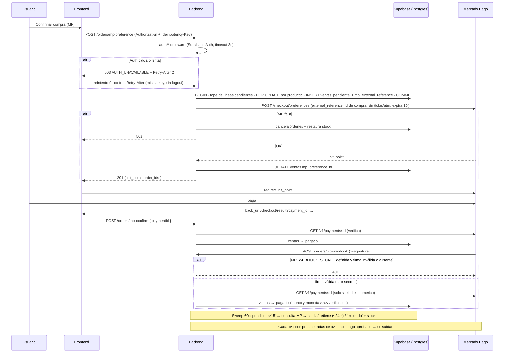

# Flujo: Checkout y ciclo de vida de una orden

## Objetivo
Comprar productos pagando con Mercado Pago o por transferencia, manteniendo el
stock y el estado de pago consistentes entre frontend, backend y Supabase.

## Actores
- Usuario (logueado vía Supabase Auth)
- Frontend React (checkout / checkout result / mis compras)
- Backend Express (`/api/orders`, `/api/shipping`)
- Mercado Pago (checkout externo + API de pagos)
- Admin (panel Ventas: transferencias)

## Pre-condiciones
- Usuario autenticado (el checkout lo exige; el token Bearer viaja vía `apiFetch`).
- Producto existente con stock suficiente (el backend no valida `status` del producto
  al reservar: solo existencia, stock y precio > 0).
- Script SQL `db/migrations/2026-10-06_idempotency_key.sql` aplicado en Supabase si el
  front manda `Idempotency-Key` (sin la columna `ventas.idempotency_key` el INSERT con key falla;
  sin header, el INSERT no la usa).
- Para MP: `MP_ACCESS_TOKEN` configurado en el backend (si falta → 503 con mensaje claro).
- Modo de compra restringida (ver sección abajo) desactivado, o el usuario debe
  estar en la allowlist.

## Modo de compra restringida (allowlist de compradores)
Gate previo a `mp-preference`/`transfer`, antes de tocar stock. El admin marca a
uno o varios usuarios como "comprador habilitado"
(`profiles.purchase_allowed_exclusive`, vía `PUT /api/users/:id`) desde
`admin/pages/Users`. No hay un switch global aparte: el modo restringido está
activo mientras exista **al menos un** perfil marcado
(`User.getPurchasePermission`, `EXISTS (... WHERE purchase_allowed_exclusive)`).
- Con el modo activo, `POST /api/orders/mp-preference` y `POST /api/orders/transfer`
  responden `403 { code: 'PURCHASES_DISABLED' }` a cualquier usuario no marcado,
  antes de reservar stock (`orderController.blockIfPurchaseNotAllowed`). El
  frontend muestra el mensaje tal cual: "Por el momento no es posible comprar.
  Sitio en mantenimiento, gracias por tu paciencia."
- Al desmarcar al último usuario, el modo se desactiva solo y la compra vuelve
  a estar habilitada para todos.
- Pensado para "modo mantenimiento" controlado en producción (ej. probar el
  checkout con una sola cuenta antes de habilitar la compra pública).

## Idempotencia del checkout (`Idempotency-Key`)
Header **opcional** en `POST /api/orders/transfer` y `POST /api/orders/mp-preference`
(`utils/idempotency.js`). El front genera un UUID por intento de compra y lo reutiliza en los
reintentos del mismo carrito. **La fuente de verdad es la base** (`ventas.idempotency_key`); la
respuesta recordada en memoria y en `public.idempotency_keys` es solo un atajo.
- **Formato:** `^[A-Za-z0-9_-]{8,128}$` (sin `:`, el separador interno). Inválido ->
  `400 IDEMPOTENCY_KEY_INVALID`, antes de tocar stock.
- **Persistencia:** cada línea del carrito (una fila de `ventas`) guarda
  `idempotency_key = <key>:<huella>:<índice de línea>`. La huella son 12 hex de un sha256 del
  carrito, el envío, el total y el medio de pago (`transfer`/`mp`): una key no cruza medios de pago.
- **Índice:** `ventas_user_idempotency_key_uidx` UNIQUE parcial sobre
  `(user_id, idempotency_key) WHERE idempotency_key IS NOT NULL`. Sin header el INSERT es el de
  siempre y no toca la columna.
- **Serialización:** la transacción de la reserva empieza con
  `pg_advisory_xact_lock(7301, hashtext(<userId>))` (`Order.lockUserCheckout`): las requests de un
  mismo usuario hacen fila, así la segunda ve lo que commiteó la primera. El mismo lock hace
  atómico el tope de reservas pendientes por usuario. Se libera solo al COMMIT/ROLLBACK.
- **Intento previo** (`resolveExistingAttempt`, después del lock y antes del tope de pendientes):
  - Todas las líneas `pendiente` y misma huella -> **replay**: `transfer` devuelve el mismo `201`
    (`order_ids`, `order_number`) sin descontar stock de nuevo. `mp-preference` solo puede
    reenviar el `init_point` si la respuesta sigue recordada; si no (la primera request todavía
    arma la preferencia, o pasaron más de 10 min) responde `409 CHECKOUT_IN_PROGRESS`.
  - Misma key con otra huella (otro carrito, envío, total o medio de pago) -> `422 IDEMPOTENCY_KEY_REUSED`.
  - Alguna línea `pagado` (o en otro estado no vivo) -> `409 CHECKOUT_ATTEMPT_CLOSED`: no se crea otra compra.
  - Todas `cancelado`/`expirado` -> el intento murió: se libera su key (`idempotency_key = NULL`)
    y la misma request crea un **intento nuevo** (stock, precio y tope se validan de cero).
- **Respuesta recordada vencida:** antes de reenviar un `201` recordado se verifica que sus
  ventas sigan `pendiente` (`Order.areAllPending`); si no, se descarta y decide la base. Un
  reintento tras cancelar o vencer nunca devuelve el `init_point` viejo.
- **Respaldo ante carrera:** si igualmente el INSERT choca con el índice (`23505`), la transacción
  hace ROLLBACK (el trigger de stock se revierte con ella, no queda ninguna venta huérfana) y se
  relee el intento ganador para reenviarlo.
- **Compensación MP:** si Mercado Pago falla después de reservar, `releaseOrders` cancela las
  órdenes, restaura stock y **libera la key**, para que el reintento con la misma key reserve de nuevo.
- **Single-flight:** además, `caches.orders.single` colapsa requests simultáneas del mismo
  usuario + mismo carrito dentro del proceso (cubre también el doble submit sin header).
- **CORS:** `Idempotency-Key` figura en `allowedHeaders` (`config/cors.js`).

## Datos de la orden: de dónde sale cada campo
- **Precio unitario:** de la fila de `productos` (`resolveUnitPrice`), nunca del body.
- **Nombre e imagen del producto:** de la fila de `productos` (`name`, `image_url`); lo que
  se persiste en `ventas` y el título/imagen que ve el comprador en Mercado Pago salen
  de la base. `productName` del body solo se valida como no vacío y se usa en mensajes de error.
- **Email del comprador:** el de la cuenta autenticada (`req.user.email`, de Supabase Auth);
  el `buyerEmail` del body solo se usa de respaldo si la cuenta no tiene email (y se sigue
  validando por formato). `buyerName` sí viene del body.
- **Costo de envío:** `local` 0, `correo` constante `CORREO_COST` (el `shippingCost` del body se
  ignora). Solo existen esos dos métodos (whitelist con `Object.hasOwn`); cualquier otro valor,
  incluido el retirado `moto`, -> 400 `INVALID_SHIPPING` antes de abrir la transacción.
- **Id de producto:** `productId` entero (`parseInt`); si no es entero -> 400 y no se
  reserva nada. Si el producto no existe -> 409 "No hay stock suficiente de ...".
- **Dueño de la orden** (`isOrderOwner`): por `ventas.user_id` cuando existe; las filas
  históricas sin `user_id` (anteriores al script 2026-09-18) se resuelven por email
  (case-insensitive). Aplica a cancelación MP y nudge. `GET /api/orders/user?email=`:
  el dueño ve lo ligado a su `user_id` o, para filas sin `user_id`, a su email; un admin
  consulta estrictamente por el email pedido.
- **Consultas por id de orden:** `id = $1::uuid` (usa `ventas_pkey`); un id mal formado no
  matchea nunca (`isUuid`) -> 404 en cancelación/confirmación.
- **Orden de locks:** antes de validar, el backend bloquea los productos del carrito en
  orden de id ascendente (`Order.lockProductsInOrder`), de modo que dos carritos cruzados
  ([A,B] y [B,A]) no se interbloquean (`40P01`).

## Modelo de stock (importante)
El descuento de stock lo hace el **trigger `trg_decrement_stock`** (AFTER INSERT en
`ventas`), que existe en la base de datos. El backend NO descuenta al crear órdenes:
- **Crear orden (INSERT en `ventas`)** → el trigger descuenta stock.
- **Antes de insertar**, el backend valida disponibilidad con la fila del producto
  bloqueada (`SELECT stock … FOR UPDATE`, con `lock_timeout` de 3 s: vencido, 503
  `ORDER_BUSY`); si no alcanza, 409 y rollback. Segunda barrera: el trigger ya no
  clampea a 0, así que el CHECK `stock >= 0` aborta un INSERT que sobrevendería.
- **Cancelar / expirar** → el backend restaura el stock.
- **Pago acreditado después de expirar** → el backend vuelve a descontar.

## Pasos principales (happy path — Mercado Pago)
1. Usuario confirma el pedido en `/checkout` y acepta el aviso de 15 minutos.
2. Front llama `POST /api/orders/mp-preference` con items, comprador y envío, más el header
   `Idempotency-Key`. No hay espera artificial previa: el botón "Continuar al pago" /
   "Ir a Mercado Pago" queda deshabilitado mientras la request está en vuelo.
3. Backend: valida el body con Zod strict (`schemas/checkoutSchema.js`: tipos, tope de 50 ítems, nombre ≤ 120 caracteres) → valida el formato de `Idempotency-Key` →
   gate de compra restringida → `MP_ACCESS_TOKEN` → **transacción corta**: toma el lock por usuario, resuelve un intento previo con la misma key, cuenta las líneas
   pendientes del usuario (tope `MAX_PENDING_LINES_PER_USER`, default 30 → 429
   `TOO_MANY_PENDING_ORDERS`), bloquea los productos en orden de `productId`
   (`SELECT … FOR UPDATE`), rechaza los productos inactivos (409 `PRODUCT_UNAVAILABLE`), valida
   stock total, talle y variantes contra la fila,
   inserta filas en `ventas` con `payment_status='pendiente'` (el trigger descuenta stock) y
   guarda en todas el **id de compra** (`mp_external_reference`, un uuid nuevo) → COMMIT →
   recién entonces crea la preferencia en MP (fuera de la transacción) con
   `external_reference` = id de compra, expiración 15 min y **medios diferidos excluidos**
   (`ticket`, `atm`: un pago en efectivo retenía el stock días) → guarda `mp_preference_id`.
   Si MP falla → compensación (`releaseOrders`) y 502.
   Nombre, imagen y precio de cada línea salen de `productos`, no del body.
4. Front guarda `mp_order_ids` en sessionStorage y redirige a `init_point`.
5. Usuario paga en Mercado Pago y vuelve a `/checkout/result?collection_status=approved&payment_id=...`.
6. Front llama `POST /api/orders/mp-confirm { paymentId }`; el backend verifica el
   pago contra la API de MP y marca las ventas como `'pagado'`. Solo si las ventas del pago
   son del usuario (mismo email que el comprador) o es admin: si no, 403 `FORBIDDEN` sin
   saldar nada. Limpia el carrito.
7. La compra aparece en "Mis compras" (`GET /api/orders/user?email=` — solo dueño o admin). Ese
   endpoint devuelve las `pagado` **y** las transferencias con `origin='wa_confirmado'` (en cualquier estado de pago).

## Idempotencia de la creación de órdenes
Ver "Idempotencia del checkout" arriba. Resumen operativo:
- Misma key + mismo carrito mientras la orden siga pendiente -> misma respuesta, sin reservar de nuevo
  (también tras un reinicio de Render: lo decide la base).
- Misma key + carrito distinto -> `422 IDEMPOTENCY_KEY_REUSED`. Key inválida -> `400 IDEMPOTENCY_KEY_INVALID`.
- Solo se recuerdan los `201`: tras un `409` (stock) o `502` (MP) el reintento se ejecuta de nuevo.
- Si la tabla `idempotency_keys` no existe o falla, el checkout NO se corta (decide la base de `ventas`).
- Cambiar nombre o email genera otra key en el front (otra compra): la orden pendiente anterior,
  si existía, expira sola por el sweep.

## Caminos alternativos
- **Transferencia:** el front llama `POST /api/orders/transfer` al backend Express
  (con Bearer token Supabase del usuario logueado y `Idempotency-Key`; el botón muestra
  "Enviando pedido..." y queda deshabilitado mientras envía). El backend valida stock con
  `SELECT … FOR UPDATE`, inserta en `ventas` (el trigger descuenta stock) y devuelve
  `order_ids`. El front abre WhatsApp con el resumen. El admin luego la resuelve en el panel Ventas:
  - Confirmar → `PATCH /api/orders/:id/confirm-transfer` → `'pagado'` (el stock ya
    se descontó al insertar; no se vuelve a tocar).
  - Cancelar → `PATCH /api/orders/:id/cancel-transfer` → `'cancelado'` + stock restaurado.
  - **Pagó después de expirar (5 h)** → `PATCH /api/orders/:id/confirm-late-transfer` (solo
    `expirado`): vuelve a descontar stock con la fila bloqueada y pasa a `'pagado'`; si ya no hay
    unidades (o el producto se borró) queda `oversold = true` → `200 { oversold }` para que el admin
    reembolse o reponga.
- **Nudge post-WhatsApp (transferencia):** cuando el usuario vuelve a la pestaña tras
  abrir WhatsApp (evento `visibilitychange`), el front muestra "¿Pudiste completar tu
  compra?" y registra la respuesta vía `POST /api/orders/nudge { orderIds, response }`
  (auth, solo dueño o admin), que escribe `ventas.origin`:
  - *Sí, ya envié el comprobante* → `origin='wa_confirmado'` (sigue `pendiente`). Desde ese
    momento la compra aparece en "Mis compras" con el aviso "Verificando tu comprobante", y pasa a
    `pagado` (con seguimiento de despacho), `cancelado` o `expirado` según lo que resuelva el admin.
  - *Todavía no* → `origin='wa_sin_confirmar'` (sigue `pendiente`, stock retenido).
  - *No, cancelar* → `origin='wa_abandonado'` + `'cancelado'` + stock restaurado.
  Es best-effort: si falla, el sweep de 5 h expira la orden igual. Idempotente (solo
  actúa sobre órdenes `transfer` que sigan `pendiente`).
- **Usuario vuelve sin pagar (failure):** CheckoutResult llama
  `POST /api/orders/mp-cancel { orderIds }` con los `order_ids` guardados (la `external_reference`
  de la URL ya no son ids de venta). El backend consulta a MP **una vez por compra**, sin retener
  conexión del pool, y responde `outcome`:
  - `released` → `'cancelado'` + stock restaurado (o ya estaba cancelada/expirada);
  - `held` → hay un pago en curso o MP no respondió: la reserva se mantiene;
  - `paid` → hay un pago aprobado: se salda (`'pagado'`) y no se cancela.
  Precedencia del agregado: `paid > held > released`. Alguna venta ajena → 403 sin tocar nada.
  `POST /api/orders/:id/cancel` sigue disponible para una orden puntual (mismo criterio).
  Tras cancelar, si ya no queda ninguna venta `pendiente` con esa `mp_preference_id`, se **expira
  la preferencia en MP** (`PUT /checkout/preferences/{id}`, sin esperar y sin que un fallo afecte la
  cancelación) para que el link de pago no siga vivo con el stock ya liberado.
- **Webhook:** si `MP_WEBHOOK_URL` está configurada (o se configura en el panel de MP),
  MP notifica `POST /api/orders/mp-webhook` y el backend marca `'pagado'` sin
  depender del navegador del usuario. **Firma:** con `MP_WEBHOOK_SECRET` definida la firma
  `x-signature` (HMAC-SHA256 sobre `id:<data.id>;request-id:<x-request-id>;ts:<ts>;`,
  comparación en tiempo constante, con `ts` de a lo sumo 5 min de antigüedad) es **obligatoria**: firma ausente, inválida o vieja ->
  `401 { success: false }` y no se consulta a MP ni se toca nada; se exige antes de
  decidir si la notificación interesa, así que también aplica a topics que no son
  `payment`. Sin `MP_WEBHOOK_SECRET`: en **producción** (`NODE_ENV=production`) el webhook falla
  cerrado con 401 `WEBHOOK_NOT_CONFIGURED` y alerta `mp_webhook_secret_missing` (una vez por
  proceso); en desarrollo/test se acepta sin verificar firma (el pago se revalida igual contra la
  API de MP) con el warning `mp_webhook_unsigned_allowed`. Solo vacía el catálogo cacheado si el
  saldo cambió la disponibilidad de un producto o talle (pago tardío que re-descuenta stock).
- **Reintento ante falla de auth (front):** si `authMiddleware` responde
  `503 AUTH_UNAVAILABLE` (ver Errores esperados), `apiFetch` espera `Retry-After` (máx. 2 s)
  y reintenta **una vez** sin cerrar sesión; como el reintento lleva la misma
  `Idempotency-Key`, no duplica la reserva.

## Errores esperados
- Sin token -> 401 "Token de autenticación requerido"; token inválido/expirado -> 401
  "Token inválido o expirado" (el front refresca la sesión y reintenta una vez).
- Falla de infraestructura al validar el token (Supabase Auth con timeout de 3 s, error de
  red o del pool de la BD) -> **503 `{ code: 'AUTH_UNAVAILABLE' }` con `Retry-After: 2`**. No es
  un 401: el front no debe cerrar la sesión de un usuario legítimo.
- `Idempotency-Key` con formato inválido -> 400 `INVALID_IDEMPOTENCY_KEY`.
- Misma key con otro carrito/envío/medio de pago -> 422 `IDEMPOTENCY_KEY_REUSED`.
- Replay de `mp-preference` sobre órdenes ya no pendientes -> 409 "Esta compra ya fue procesada, cancelada o venció...".
- Producto del carrito sin `productId` entero -> 400 "No se pudo identificar el producto ...".
- Producto inexistente o sin stock suficiente -> 409 "No hay stock suficiente de ..."; precio no vendible (<= 0) -> 409 "no está disponible para la venta"; nada se persiste.
- Producto inactivo (`status` distinto de `active`) -> 409 "no está disponible para la venta", igual que un precio no vendible: el catálogo lo oculta y la API tampoco lo vende por id directo.
- El usuario ya tiene `MAX_PENDING_LINES_PER_USER` líneas (default 30) **o** `MAX_PENDING_UNITS_PER_USER` unidades (default 60) pendientes de pago, contando lo que está pidiendo -> 429 `TOO_MANY_PENDING_ORDERS` "Tenés compras pendientes de pago. Pagalas o cancelalas antes de iniciar otra." Una repetición con la misma `Idempotency-Key` no cuenta (se resuelve antes). El tope por unidades existe porque una sola línea puede llevar muchas unidades.
- Una línea con más de `MAX_QUANTITY_PER_LINE` unidades (default 20) -> 400 `VALIDATION_ERROR` "Podés comprar hasta 20 unidades de ... por compra." (sin esto, una línea reservaba todo el stock de un producto: 15 min en MP, 5 h en transferencia).
- Más de 8 compras por minuto desde la misma cuenta (`POST /transfer` y `/mp-preference` comparten el cupo) -> 429 `RATE_LIMITED`. Hay además un tope por IP (12/min) que se evalúa antes de autenticar; el de 8/min cuenta por usuario. Las cancelaciones y confirmaciones que pueden consultar a MP (`mp-confirm`, `mp-cancel`, `/:id/cancel`) tienen un tope por usuario de 20/min.
- `unitsConfig` que no sea una lista de objetos planos de texto (máximo una entrada por unidad, claves <= 60 y valores <= 100 caracteres), o `buyerName` > 120 caracteres -> 400.
- `mp-confirm` y el webhook ignoran pagos con `paymentId` no numérico o con moneda distinta de ARS (no saldan ninguna orden).
- Método de envío desconocido (cualquier valor fuera de `local`/`correo`) -> 400 `INVALID_SHIPPING`.
- Body del checkout con tipos o claves inválidas (strict) -> 400 `VALIDATION_ERROR` `{ success, code, message, details[] }`, antes de tomar ningún lock.
- Reintento con la misma `Idempotency-Key` sobre una compra ya pagada -> 409 `CHECKOUT_ATTEMPT_CLOSED`; con la preferencia de MP aún en armado -> 409 `CHECKOUT_IN_PROGRESS`.
- Error inesperado durante la reserva -> 500 "No se pudo registrar la orden. Intentá de nuevo." con rollback.
- Webhook con `MP_WEBHOOK_SECRET` y firma ausente/inválida -> 401.
- Modo de compra restringida activo y usuario no habilitado → 403 `PURCHASES_DISABLED`.
- Stock insuficiente al crear preferencia o transferencia → nada se persiste y el body trae
  `{ code, message, productId, size? }`: `OUT_OF_STOCK` 409 (total, producto inexistente o stock
  NULL), `SIZE_OUT_OF_STOCK` 409, `SIZE_UNAVAILABLE` 409 (talle eliminado), `SIZE_REQUIRED` 400,
  `INVALID_VARIANT` 400, `INVALID_PRODUCT_ID` 400. El `code` llega igual a través del single-flight
  y de la idempotencia (solo se recuerdan los 201).
- MP caído / token inválido → 502 `MP_UNAVAILABLE` "No se pudo conectar con Mercado Pago…"; la
  reserva se compensa (ventas `cancelado` + stock devuelto).
- Id de orden con formato inválido (no uuid) → 400 `INVALID_ORDER_ID`.
- `MP_ACCESS_TOKEN` ausente → 503 "Los pagos con Mercado Pago no están disponibles…".
- Consulta/cancelación de órdenes ajenas → 403.
- Orden ya pagada al intentar cancelar → 409.
- Cancelar con un pago aprobado o en curso en MP: aprobado → se salda y responde 409; en curso
  → `200 { released: false }` y la reserva se mantiene (la consulta a MP va antes de la
  transacción, sin retener el lock).

## Expiración (sweep cada 60 s en el backend)
- MP `pendiente` > 15 min: antes de expirar se le pregunta a MP por los pagos de esa compra
  (`external_reference`, `GET /v1/payments/search`, últimos 50 intentos):
  - **aprobado** → se salda (`pagado`, se guarda `mp_payment_id`);
  - **en curso** (`pending`/`in_process`/`authorized`) o consulta fallida → se retiene el stock
    hasta **24 h** desde la creación (sin medios diferidos, un pago en curso se resuelve rápido);
  - **ninguno**, o pasadas las 24 h → `'expirado'` + stock restaurado (total y talle).
  `in_mediation` (disputa de un pago ya aprobado) no retiene.
  Límites por ciclo: hasta `ORDER_SWEEP_MAX_MP_LOOKUPS` (10) consultas, 4 en paralelo. Las compras
  consultadas hace menos de 5 min **se excluyen de la consulta SQL** del lote (200 más viejas), para que
  las retenidas no ocupen siempre los mismos lugares y dejen sin evaluar a las vencidas más nuevas. Rotación en
  memoria: primero las compras nunca consultadas o consultadas hace más; una compra retenida no se
  reconsulta antes de 5 min. Cada compra se procesa con su propio try/catch (un error no aborta el
  ciclo) y las transferencias son un paso independiente.
  Las compras con `review_reason` (ej. `amount_mismatch`) **no gastan consultas**: se expiran
  recién al pasar las 24 h y la marca queda para el admin.
  Las ventas sin `mp_external_reference` (anteriores a la conciliación) expiran por tiempo.
- Transferencia `pendiente` > 5 h → `'expirado'` + stock restaurado.
- **Conciliación de compras cerradas** (dentro del sweep, como máximo cada 15 min): toma compras MP
  `expirado`/`cancelado` de las últimas 48 h sin `review_reason` (máx. 10 por pasada, rotando) y, si
  MP tiene un pago `approved`, lo salda como pago tardío. Log `closed_order_reconciled`.
- Pago acreditado después de expirar: `mp-confirm`/webhook/conciliación pasa `'expirado'` →
  `'pagado'` y vuelve a descontar. Si ya no hay unidades (total o talle), el producto se borró o su
  stock es NULL, NO hace clamp: la venta queda `pagado` con `oversold = true` y un log
  `oversold_late_payment`; el panel Ventas la marca "Sin stock: reembolsar".
- **`review_reason`** (detección para el admin; no cambia estado ni stock):
  - `amount_mismatch` → pago aprobado cuyo monto no coincide con el total (o no es un número): no
    se salda; log `payment_amount_mismatch`.
  - `duplicate_payment` → segundo pago aprobado con otro `payment_id` para ventas ya pagadas; log
    `duplicate_approved_payment`.
  - `refunded` / `charged_back` → el webhook notifica un reembolso o contracargo del pago que saldó
    la venta; log `payment_reversed`. Una **devolución parcial** (el pago sigue `approved` pero trae
    `transaction_amount_refunded` > 0) también queda `refunded`. Solo se detecta por webhook: si MP no
    lo envía, hay que mirar el panel de MP.
- `external_reference` de pagos viejos (lista de ids de venta separados por coma) se sigue
  resolviendo: primero se buscan ventas con esa `mp_external_reference`; si no hay, se parsea la lista.

## Diagrama

## Datos involucrados
- **Entrada:** items (productId, cantidad, variantes; los precios del body se validan
  pero no se usan para cobrar), nombre del comprador, envío, header `Idempotency-Key`.
- **Persistencia:** `public.ventas` (una fila por producto; el costo de envío se
  suma a la primera línea; `user_id`, `mp_external_reference`), `public.productos.stock`,
  `public.idempotency_keys` (respuestas `201` por `Idempotency-Key`).
- **Estados de `payment_status`:** `pendiente → pagado | cancelado | expirado`
  (`fallido` no lo escribe ningún código; la base lo rechaza con `ventas_payment_status_check`).
- **Stock por talle:** `productos.variants[].stockByOption` lo valida y descuenta el backend en
  `reserveOrders` con la fila bloqueada (el trigger solo descuenta `stock`); cancelar/expirar
  lo devuelve al talle de cada unidad (`ventas.units_config`). Talle agotado → 409; unidad sin
  talle → 400. `units_config` se guarda saneado contra las variantes reales (`[]` si el producto
  no tiene variantes).
- **`ventas.review_reason`**: `null` · `amount_mismatch` · `duplicate_payment` · `refunded` ·
  `charged_back` (ver Expiración). Un pago en otra moneda que ARS queda como `amount_mismatch`.
- **Edición de productos por el admin**: `PUT /api/products/:id` con `expectedUpdatedAt` (obligatorio si el body trae `stock` o
  `variants`, 400 si falta) devuelve
  409 `PRODUCT_CHANGED` si una compra cambió el producto mientras el admin lo editaba (no pisa el
  stock descontado). Borrar un producto con ventas `pendiente` → 409 `PRODUCT_HAS_PENDING_ORDERS`.
- **`ventas.origin`** (respuesta del nudge post-WhatsApp): `null` (sin responder / MP) ·
  `wa_confirmado` · `wa_sin_confirmar` · `wa_abandonado`.
