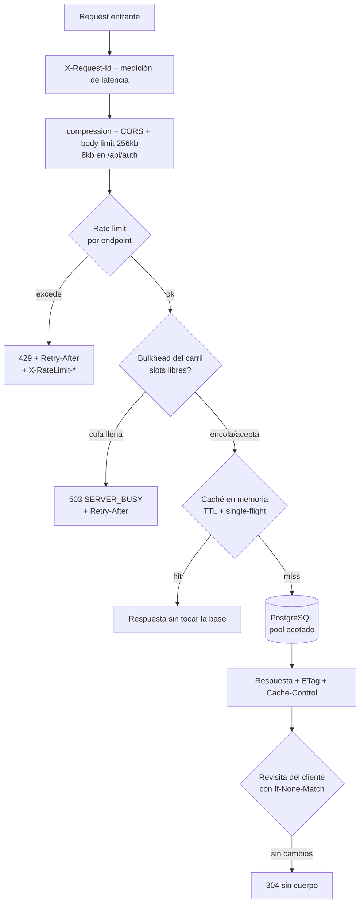
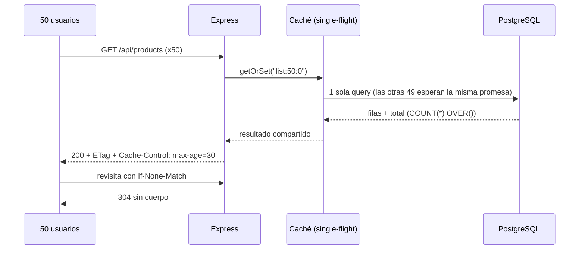
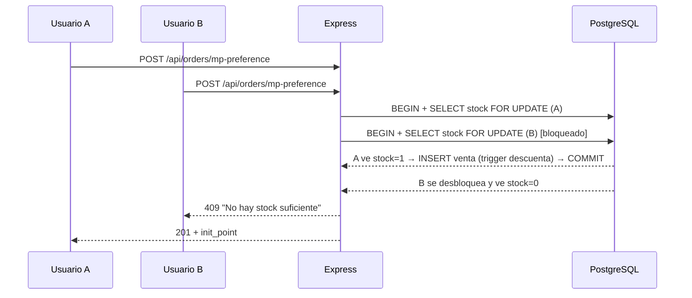
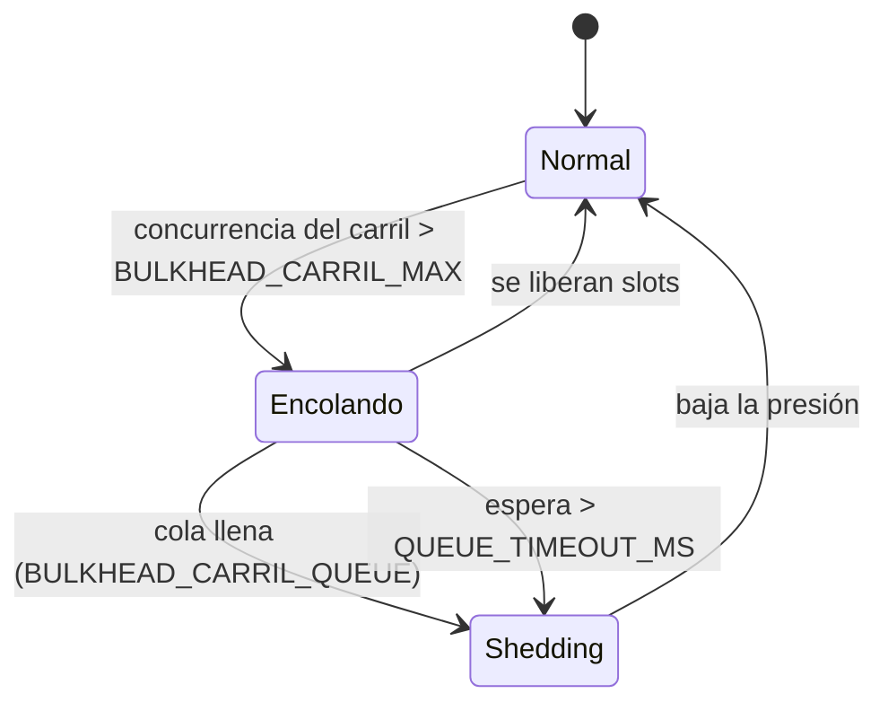
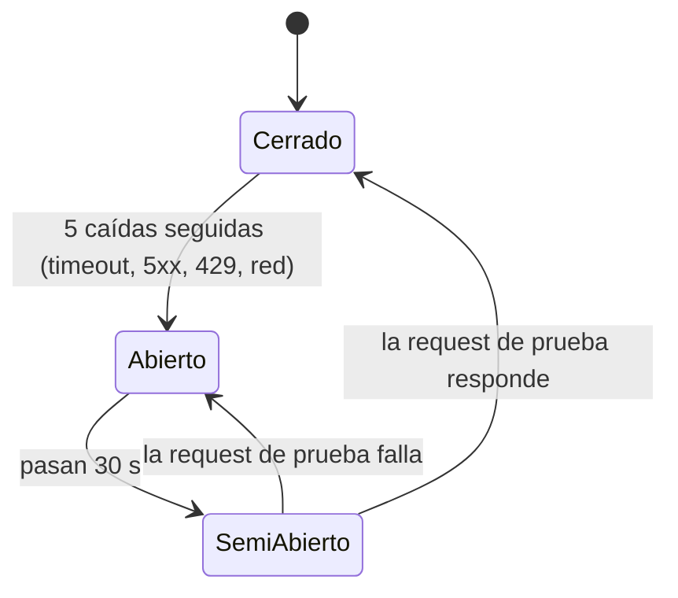

# Flujo: concurrencia y carga en el backend

## Objetivo
Que muchos usuarios simultáneos se atiendan de forma eficiente, sin bloquear el
event loop, sin agotar el pool de PostgreSQL y sin que un pico degrade a todos:
ante saturación se degrada de forma **predecible** (503 con `Retry-After`) en
lugar de colapsar.

## Actores
- Usuario del sitio (catálogo, checkout) y administradora (panel, asistente).
- Backend Express (instancia única en Render).
- PostgreSQL / Supabase (pooler en **modo sesión**, techo de **15 clientes**).
- Servicios externos: Mercado Pago, Supabase Auth, Cloudinary.

## Pre-condiciones
- Backend detrás de un proxy que setea `X-Forwarded-For` (`trust proxy` activo).
- Variables de la §8.1 de `DOCUMENTACION_BACKEND.md` (todas con default).

---

## Capas de defensa (en orden de ejecución)

| Capa | Qué resuelve | Dónde vive |
|---|---|---|
| Caché HTTP (`Cache-Control` + `ETag` + 304) | Evita que la lectura llegue siquiera al backend | `middleware/httpCache.js` |
| Compresión gzip | Menos bytes y menos tiempo de socket por respuesta | `server.js` |
| Rate limit por endpoint | Abuso, fuerza bruta y scraping | `middleware/rateLimit.js` |
| Bulkhead por carril + cola | Que la concurrencia no supere lo que la base aguanta y que una dependencia lenta no frene al resto | `middleware/concurrencyLimit.js` |
| Circuit breaker de Mercado Pago | Con MP caído, fallar al instante (sin reservar stock) en vez de esperar 8 s por intento | `utils/circuitBreaker.js`, `utils/mercadopago.js` |
| Timeouts de dependencias | Supabase Auth 5 s, Cloudinary 8 s, Mercado Pago 8 s, base 10 s | `utils/fetchWithTimeout.js`, `utils/cloudinaryHttp.js` |
| Plazo por request | Red de seguridad de 25 s (no aplica a `/api/orders`) | `middleware/requestDeadline.js` |
| Observabilidad | `X-Request-Id`, p50/p95/p99 por ruta, `/health` y `/ready` | `middleware/requestObserver.js`, `utils/requestMetrics.js`, `services/readiness.js` |
| Caché en memoria + single-flight | Que N lecturas iguales sean 1 sola query | `utils/cache.js` |
| Pool acotado + timeouts | Que una query colgada no se lleve puesto al resto | `config/database.js` |
| Paginación | Que ninguna respuesta crezca sin techo | product/order controllers |
| Transacciones cortas + `FOR UPDATE` | Consistencia de stock sin sobreventa | `controllers/orderController.js` |
| Apagado ordenado | No cortar requests en vuelo en cada deploy | `server.js` |

---

## Camino 1 — Lectura concurrente del catálogo (happy path)

50 usuarios abren el catálogo al mismo tiempo con la caché fría:

Medido en local (`node qa/load-test.js`): **p90 ≈ 30 ms con 50 usuarios
simultáneos, 0 % de error**, con la caché absorbiendo la mayoría de las lecturas.

## Camino 2 — Compra concurrente del último ítem

Dos usuarios compran la última unidad al mismo tiempo:

La llamada HTTP a Mercado Pago ocurre **después** del COMMIT: si se hiciera
dentro de la transacción, cada checkout retendría una conexión del pool durante
todo el round trip externo. Si Mercado Pago falla, se compensa cancelando las
reservas y devolviendo el stock (`releaseOrders`), y el sweep de órdenes vencidas
queda como red de seguridad.

## Camino 3 — Doble submit (doble click en "Pagar")

La segunda request con el mismo usuario y el mismo carrito, mientras la primera
sigue en vuelo, **comparte la misma ejecución** (single-flight por hash del
payload) en vez de crear un segundo juego de ventas y descontar stock dos veces.

## Camino 4 — Saturación

Hay un bulkhead por **carril**; cada uno degrada por su cuenta:

| Carril | Rutas | Slots (default) | Cola |
|---|---|---|---|
| `read` | catálogo, envío y lecturas (incluye `GET /api/orders/user`) | `DB_POOL_MAX` (12) | 200 |
| `auth` | `/api/auth/*` | 6 | 50 |
| `checkout` | `POST /api/orders/*` salvo el webhook (crear, confirmar y cancelar compras) | 6 | 50 |
| `admin` | `/api/admin/*`, `/api/users/*`, `/api/cloudinary/*`, `PATCH /api/orders/*` | 4 | 20 |
| `webhook` | `POST /api/orders/mp-webhook` (reservado) | 4 | 50 |

La suma de los slots supera el pool a propósito (el catálogo sale casi siempre de la caché); los topes son un punto de partida a ajustar con las pruebas de carga.

Verificado con 800 requests concurrentes **todas cache-miss** (con el bulkhead
único anterior, antes de separar carriles): 224 respondidas con 200, 576 con
**503 + `Retry-After`**, **0 errores 500**, pool sin exceder su máximo y cola
drenada a 0 al terminar. Con los carriles separados falta repetir la medición.

## Camino 5 — Mercado Pago caído (circuit breaker)

- Con el circuito **abierto**, `POST /api/orders/mp-preference` responde `502 MP_UNAVAILABLE`
  **antes de reservar stock** ("elegí transferencia"); la transferencia no se ve afectada.
- Un 4xx de MP (pago inexistente, request inválida) no cuenta como caída.
- Las **lecturas** a MP (`getPayment`, búsqueda por referencia) se reintentan una vez con
  backoff y jitter solo ante fallas rápidas (5xx, 429, corte de red); un timeout no se
  reintenta. Crear la preferencia nunca se reintenta.
- Con el circuito abierto, el sweep trata la consulta a MP como `unknown` y **no libera
  stock** (la compra se reevalúa en el ciclo siguiente).
- El estado del circuito se ve en `GET /health` (`mercadopago.circuit`).

## Observabilidad

- Toda respuesta lleva `X-Request-Id` (se respeta uno entrante solo si tiene forma segura);
  el mismo id va en cada línea de log de esa request.
- `GET /health` con `HEALTH_DETAIL_TOKEN` expone `requests.routes[...]` (conteos por clase de
  status y p50/p95/p99 sobre las últimas 500 requests de cada ruta), el estado de cada
  carril y el pool. Se pierde al reiniciar.
- Se loguean las requests lentas (`SLOW_REQUEST_MS`, default 1000) y las 5xx;
  `ACCESS_LOG_ALL=true` loguea todas (solo para una prueba de carga puntual).
- `GET /ready` hace un `SELECT 1` con plazo de 2 s (resultado memorizado 3 s): 200 `READY` o
  503 `NOT_READY`. Es para un monitor externo con alertas; el Health Check de la plataforma
  conviene dejarlo en `/health` (reiniciar el proceso no arregla una caída de la base).

---

## Errores esperados

| Situación | Respuesta | Cabeceras |
|---|---|---|
| Excede el rate limit del endpoint | `429` `{ code: 'RATE_LIMITED' }` | `Retry-After`, `X-RateLimit-Limit/Remaining/Reset` |
| Cola de concurrencia del carril llena o espera agotada | `503` `{ code: 'SERVER_BUSY' }` | `Retry-After: 2` |
| Handler que no responde en 25 s (todo salvo `/api/orders`) | `503` `{ code: 'REQUEST_TIMEOUT' }` | `Retry-After: 2` |
| Supabase Auth no responde (login, refresh, recuperación) | `503` `{ code: 'AUTH_UNAVAILABLE' }` | `Retry-After: 2` |
| Mercado Pago caído (circuito abierto o falla al crear la preferencia) | `502` `{ code: 'MP_UNAVAILABLE' }` | — |
| Body mayor a 256 kb (8 kb en `/api/auth/*`) | `413` `{ code: 'PAYLOAD_TOO_LARGE' }` | — |
| JSON malformado | `400` `{ code: 'INVALID_JSON' }` | — |
| Falla de base o infraestructura | `500` `{ code: 'INTERNAL_ERROR' }` genérico | El detalle va al log, nunca al cliente |
| Stock insuficiente al reservar | `409` con el nombre del producto | — |

## Datos involucrados
- **Entrada:** requests HTTP; sin persistencia propia de estas capas.
- **Estado en memoria (por proceso):** contadores de rate limit, colas de los
  bulkheads, estado del circuit breaker, métricas de latencia y cachés con TTL. Nada de esto es fuente de verdad: reiniciar el
  proceso sólo pierde caché y contadores.
- **Persistencia:** sin cambios de esquema. Sí se agregan **índices** de soporte
  en `db/migrations/2026-08-08_add_performance_indexes.sql`.

## Límites conocidos
- Todo el estado es **por proceso**. Si el backend escala a más de una instancia:
  los límites de rate se multiplican por instancia y cada una tendrá su propia
  caché (divergencia acotada por los TTL, que son cortos). El paso siguiente sería
  mover ambos a Redis; el store del rate limit ya está preparado para inyectarse.
- `CACHE_TTL_AUTH_SECONDS` define cuánto puede sobrevivir un token ya revocado.
- El techo duro de la base es el pooler de Supabase (**15 clientes**), no el
  backend: subir `DB_POOL_MAX` sin ampliarlo allá reintroduce `EMAXCONNSESSION`.
