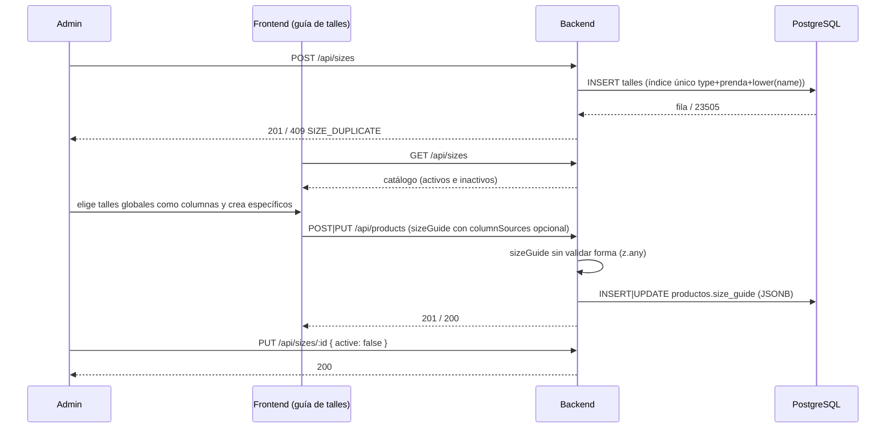

# Flujo: Catálogo de talles

## Objetivo
Definir los talles y sus medidas una sola vez (catálogo global) para elegirlos como columnas de la "Guía de talles" de un producto. Los talles específicos de un producto no pasan por el catálogo: se crean en el propio formulario del producto y viven dentro de su guía.

## Actores
- Admin (rol `admin`).
- Cliente público (solo lectura del catálogo).
- Backend (`/api/sizes`, `/api/products`).
- PostgreSQL/Supabase (`public.talles`, `public.productos.size_guide`).

## Pre-condiciones
- Scripts SQL `db/migrations/2026-10-26_create_talles_catalog.sql` y `db/migrations/2026-10-26_add_garment_to_talles.sql` aplicados.
- Para escribir: admin con access token válido.

## Pasos principales (happy path)
1. El admin crea un talle: `POST /api/sizes { name, type, garment?, measurements? }`. El backend normaliza `name` a mayúsculas, recorta `garment` (prenda, opcional; vacío = sin prenda) y responde 201.
2. Cualquier cliente lee el catálogo con `GET /api/sizes` (todos los talles, activos e inactivos, ordenados por `type`, `garment` (sin prenda primero), `name`; cacheable 30 s).
3. En el editor de la guía de talles de un producto, el admin elige talles globales del catálogo como columnas y crea los específicos del producto en el mismo formulario.
4. La guía se guarda tal cual en `productos.size_guide` (JSONB; el body de `POST|PUT /api/products` la recibe como `sizeGuide`). Puede incluir `columnSources`, un mapa nombre de columna → `{ sizeId }` que indica qué columnas vienen del catálogo.
5. Para dejar de ofrecer un talle, el admin lo desactiva: `PUT /api/sizes/:id { active: false }`. No hay borrado.

## Caminos alternativos
- Guías existentes sin `columnSources` siguen funcionando igual: el backend no exige ni interpreta ese campo.
- Si un talle del catálogo se desactiva o se edita, el backend no toca las guías ya guardadas (no hay relación en la base entre `size_guide` y `talles`).
- `variants[].optionMeta` (`{ source: 'global', sizeId }` o `{ source: 'custom', measurements? }` en la variante de talle) sigue siendo aceptado y validado por el backend (un `sizeId` inexistente da 400 `SIZE_NOT_FOUND`), pero el frontend ya no lo envía ni lo usa. No se eliminó para no romper compatibilidad con datos y clientes existentes. Es solo metadata: el stock por talle, el checkout y `utils/variantStock.js` no lo leen.
- La variante Talle del producto es de texto libre con stock por talle; es independiente del catálogo.

## Errores esperados
- Body inválido (nombre vacío o de más de 20 caracteres, tipo desconocido, más de 8 medidas, claves `__proto__`/`constructor`/`prototype`) → 400 `VALIDATION_ERROR` con `details`.
- Mismo `type` + prenda + nombre (sin distinguir mayúsculas; sin prenda cuenta como prenda vacía) → 409 `SIZE_DUPLICATE`. La misma "M" con otra prenda es válida.
- `garment` de más de 30 caracteres → 400 `VALIDATION_ERROR`.
- `PUT` sobre un id inexistente → 404 `SIZE_NOT_FOUND`; id que no es UUID → 400 `INVALID_SIZE_ID`; body sin campos → 400 `NO_FIELDS`.
- `size_guide` / `columnSources`: sin validación de forma en el backend (`z.any()`); un `sizeId` dentro de `columnSources` no se verifica contra el catálogo.
- Producto con `optionMeta` global cuyo `sizeId` no existe → 400 `SIZE_NOT_FOUND` (solo si un cliente aún envía `optionMeta`).
- Sin token → 401; usuario sin rol admin → 403.
- Falla de base → 500 `INTERNAL_ERROR` (el detalle va al log estructurado).

## Diagrama

## Datos involucrados
- Entradas: `name`, `type` (`indumentaria` | `calzado`), `garment` (opcional, 1-30 caracteres, `null` la borra), `measurements` (objeto de texto, máx. 8 claves), `active`; en productos, `sizeGuide` (con `columnSources` opcional) y, sin uso del frontend, `variants[].optionMeta`.
- Salidas: `Size = { id, name, type, garment, measurements, active, createdAt, updatedAt }`; los productos devuelven la guía en la columna `size_guide`.
- Persistencia: `public.talles` (RLS: lectura pública, escritura solo por el backend) y `productos.size_guide` (jsonb, se guarda tal cual).
