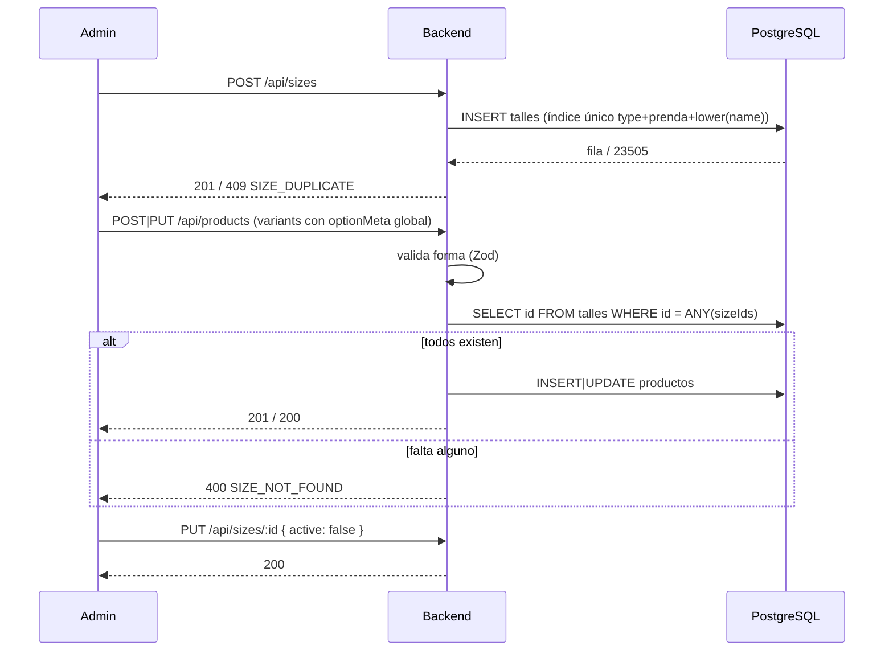

# Flujo: Catálogo de talles

## Objetivo
Definir los talles y sus medidas una sola vez y reutilizarlos en las variantes de talle de los productos.

## Actores
- Admin (rol `admin`).
- Cliente público (solo lectura del catálogo).
- Backend (`/api/sizes`, `/api/products`).
- PostgreSQL/Supabase (`public.talles`, `public.productos.variants`).

## Pre-condiciones
- Scripts SQL `db/migrations/2026-10-26_create_talles_catalog.sql` y `db/migrations/2026-10-26_add_garment_to_talles.sql` aplicados.
- Para escribir: admin con access token válido.

## Pasos principales (happy path)
1. El admin crea un talle: `POST /api/sizes { name, type, garment?, measurements? }`. El backend normaliza `name` a mayúsculas, recorta `garment` (prenda, opcional; vacío = sin prenda) y responde 201.
2. Cualquier cliente lee el catálogo con `GET /api/sizes` (todos los talles, activos e inactivos, ordenados por `type`, `garment` (sin prenda primero), `name`; cacheable 30 s).
3. Al guardar un producto, cada opción de la variante de talle puede llevar `optionMeta[OPCIÓN] = { source: 'global', sizeId }` (usa las medidas del catálogo) o `{ source: 'custom', measurements? }` (medidas propias del producto).
4. El backend valida la forma en el borde y, si hay opciones `global`, comprueba en una sola query que todos los `sizeId` existan.
5. Para dejar de ofrecer un talle, el admin lo desactiva: `PUT /api/sizes/:id { active: false }`. No hay borrado.

## Caminos alternativos
- Si el talle existe pero está inactivo, los productos que ya lo referencian lo conservan (no se valida `active` al guardar productos).
- Si el producto no usa el catálogo, sigue funcionando con `sizeGuide` (campo legado, solo lectura) o sin metadata.
- `optionMeta` es solo metadata: el stock por talle, el checkout y `utils/variantStock.js` no lo leen.

## Errores esperados
- Body inválido (nombre vacío o de más de 20 caracteres, tipo desconocido, más de 8 medidas, claves `__proto__`/`constructor`/`prototype`) → 400 `VALIDATION_ERROR` con `details`.
- Mismo `type` + prenda + nombre (sin distinguir mayúsculas; sin prenda cuenta como prenda vacía) → 409 `SIZE_DUPLICATE`. La misma "M" con otra prenda es válida.
- `garment` de más de 30 caracteres → 400 `VALIDATION_ERROR`.
- `PUT` sobre un id inexistente → 404 `SIZE_NOT_FOUND`; id que no es UUID → 400 `INVALID_SIZE_ID`; body sin campos → 400 `NO_FIELDS`.
- Producto con `sizeId` global que no existe → 400 `SIZE_NOT_FOUND`.
- Sin token → 401; usuario sin rol admin → 403.
- Falla de base → 500 `INTERNAL_ERROR` (el detalle va al log estructurado).

## Diagrama

## Datos involucrados
- Entradas: `name`, `type` (`indumentaria` | `calzado`), `garment` (opcional, 1-30 caracteres, `null` la borra), `measurements` (objeto de texto, máx. 8 claves), `active`; en productos, `variants[].optionMeta`.
- Salidas: `Size = { id, name, type, garment, measurements, active, createdAt, updatedAt }`.
- Persistencia: `public.talles` (RLS: lectura pública, escritura solo por el backend) y `productos.variants` (jsonb).
